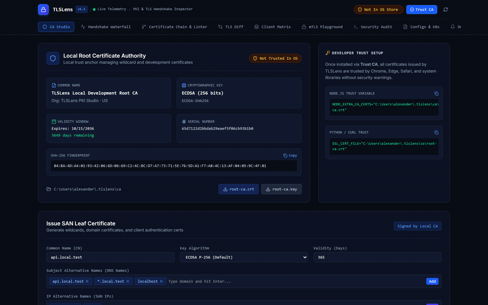
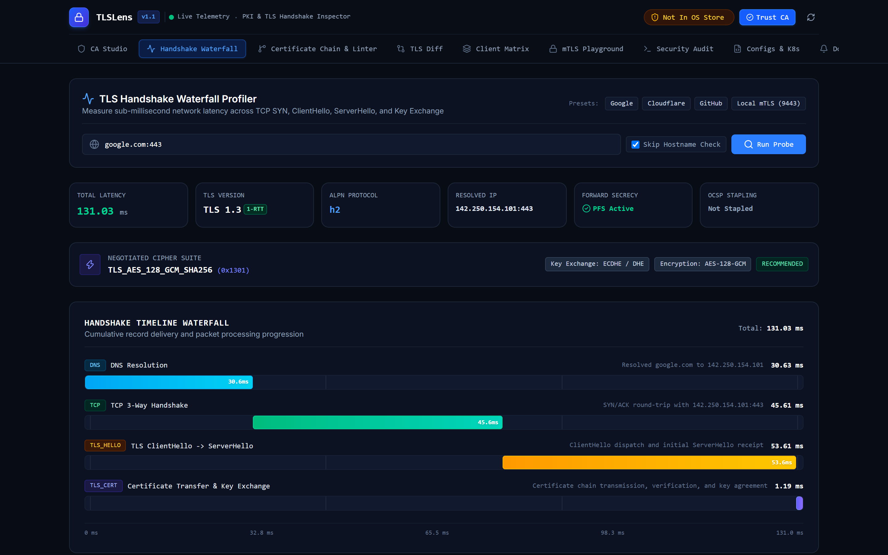
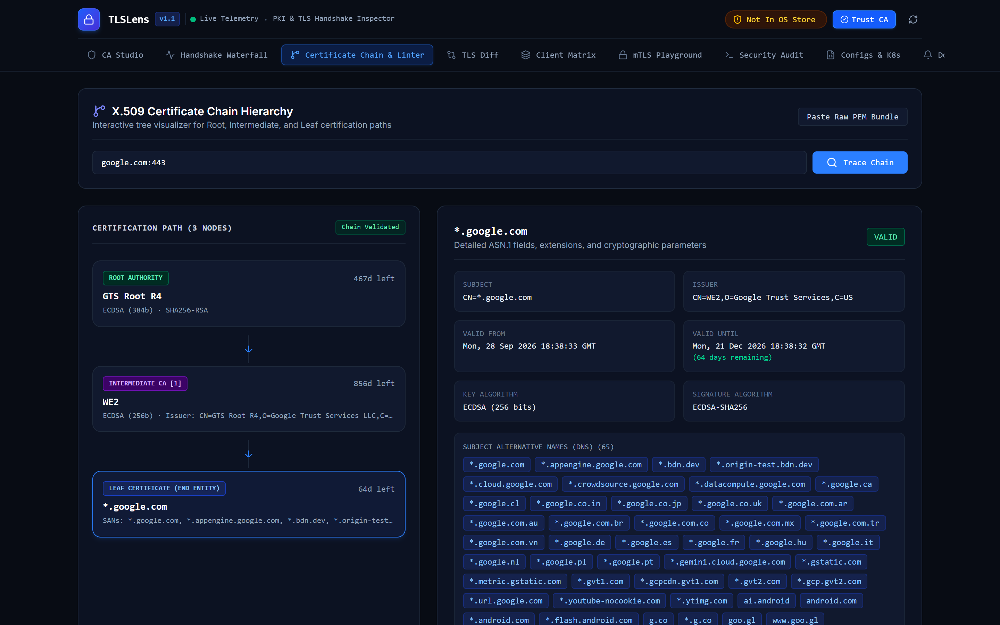
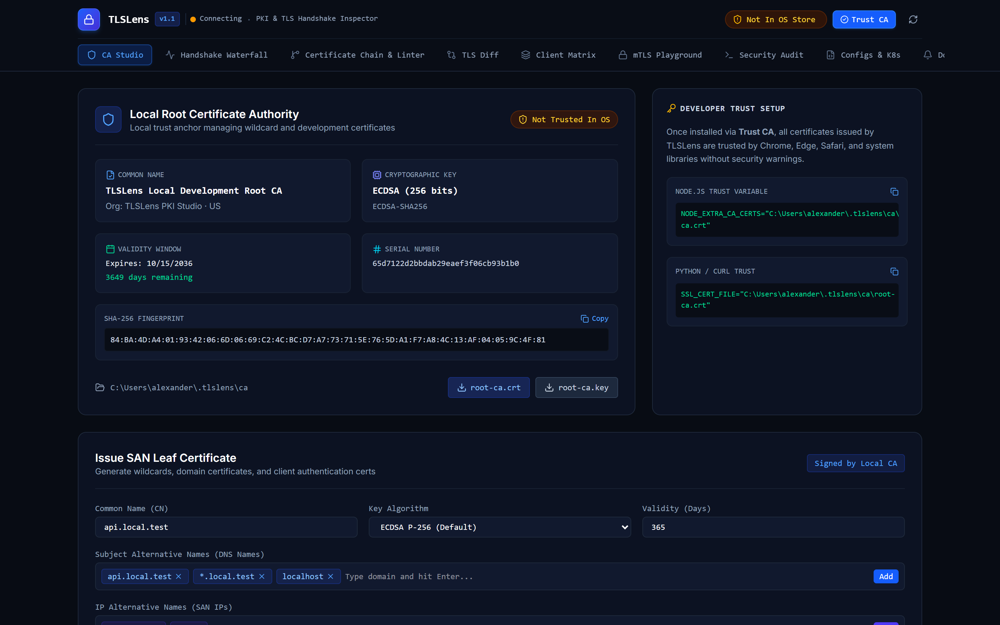
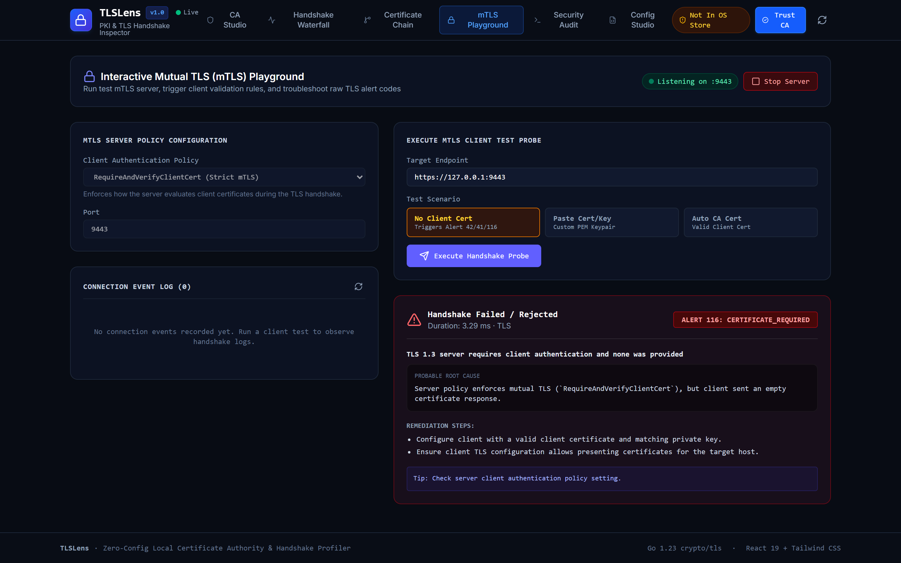

<p align="center">
  
</p>

<h1 align="center">TLSLens</h1>

<p align="center">
  <strong>Local Certificate Authority, RFC 8555 ACME Server, mTLS Alert Diagnostics &amp; TLS Handshake Inspector</strong>
</p>

<p align="center">
  
  
  
  
</p>

<p align="center">
  
</p>

TLSLens is a developer diagnostics tool and PKI workbench for debugging TLS configurations, mutual TLS (mTLS) authentication failures, and certificate chains. It generates trusted local root CAs with 1 click, registers them in the operating system root store (Windows, macOS, Linux), troubleshoots mTLS connection alerts, simulates client compatibility matrices, audits CAB Forum compliance rules, and visualizes sub-millisecond TLS 1.3 and 1.2 handshake timelines.

---

## Capabilities

- **Zero-Config Local CA**: Generates ECDSA P-256 and RSA root CAs with automatic registration in Windows CertStore, macOS Keychain, and Linux ca-certificates.
- **Embedded RFC 8555 ACME Server**: Provides a local ACME directory (`/acme/directory`) for automated issuance to Caddy, Traefik, Certbot, and Kubernetes cert-manager without external rate limits.
- **Side-by-Side TLS & Certificate Diff**: Runs concurrent dual-host handshakes to highlight differences in ciphers, SANs, chain depth, and stage latencies.
- **X.509 Compliance & CAB Forum Linter**: Evaluates certificates against CAB Forum Baseline Requirements and RFC 5280 constraints, flagging key sizes, SAN deprecation, and lifespan limits.
- **Client Compatibility Matrix Scanner**: Probes targets against real-world client configurations (Android, iOS, Chrome, Firefox, Java, OpenSSL) to evaluate protocol negotiation.
- **Interactive mTLS Playground & Alert Simulator**: Runs an in-memory mTLS server with configurable client authentication policies and simulates fatal TLS alerts (40, 42, 45, 46, 48, 112, 116).
- **Handshake Alert Diagnostics**: Detects and translates raw TLS alert codes into concrete remediation steps.
- **TLS Handshake Waterfall Profiler**: Measures sub-millisecond breakdowns across DNS resolution, TCP SYN/ACK, ClientHello, ServerHello, Certificate Validation, and Key Exchange.
- **Continuous Domain Watcher**: Tracks expiration dates and certificate fingerprints in the background, broadcasting WebSocket alerts before expiration.
- **Kubernetes Native Export Studio**: Generates kubernetes.io/tls Secrets, CA ConfigMaps, cert-manager ClusterIssuers, and Ingress TLS definitions.
- **Reverse Proxy & Client Configs**: Generates validated configuration snippets for Nginx, Caddy, Envoy, Apache, Docker, cURL, Go, Node.js, and Python.

---

## Interface Overview

| Feature | Description |
|---|---|
| **CA Studio** | Generate local Root CA, install or remove from OS trust store, issue leaf certificates, and export PEM/PKCS#12 bundles |
| **Handshake Waterfall** | Measure sub-millisecond latency for TCP Connect, TLS ClientHello, ServerHello, Certificate Validation, and Key Exchange |
| **Certificate Chain & Linter** | Visual hierarchy displaying Subject, Issuer, Expiration countdown, Key Usage extensions, and CAB Forum compliance checks |
| **Side-by-Side Diff** | Concurrent comparative analysis between two targets or staging vs production environments |
| **Client Matrix** | Compatibility matrix testing Android, iOS, Chrome, Java, and OpenSSL client profiles |
| **mTLS & Alert Simulator** | Test bidirectional client certificate verification and trigger fatal TLS alert frames |
| **Security Audit** | Security grading (A+ to F), protocol compatibility matrix, and cipher suite evaluation |
| **Configs & Kubernetes** | Export reverse proxy configs, runtime environment variables, and kubernetes.io/tls manifests |
| **Domain Watcher** | Continuous background monitoring with certificate expiry countdowns and alerts |
| **ACME Server** | Local RFC 8555 directory with automated orders log and integration templates |

<p align="center">
  
  
</p>

<p align="center">
  
  
</p>

---

## Quick Start

### Installation

Compile directly from source with Go 1.23+:

```bash
# Clone the repository
git clone https://github.com/alexandrmotologa/tlslens.git
cd tlslens

# Build the embedded single binary
go build -o tlslens.exe ./cmd/tlslens
```

### Starting the Studio

Run the integrated web studio and API server:

```bash
tlslens serve --port 8080
```

Open `http://localhost:8080` in your browser.

---

## Command Line Usage

TLSLens can be operated both via the visual web studio and directly through the command line.

### Initialize Local Root CA

```bash
# Generate root CA with ECDSA P-256 (default)
tlslens ca init

# Or generate with RSA 2048
tlslens ca init --key-type rsa
```

### Manage OS Trust Store

```bash
# Register the local root CA in your operating system trust store
tlslens ca trust

# Verify trust store status
tlslens ca status

# Remove root CA from trust store
tlslens ca untrust
```

### Issue Leaf Certificates

```bash
# Issue a wildcard development certificate with SANs
tlslens cert issue --domains "localhost,api.local.test,*.local.test" --ips "127.0.0.1,::1" --out ./certs
```

This creates:
- `./certs/cert.pem`: Leaf certificate with full SAN extensions
- `./certs/key.pem`: Private key
- `./certs/bundle.pem`: Combined leaf and root CA chain
- `./certs/cert.p12`: PKCS#12 archive for browser or system import

### Inspect a TLS Endpoint

```bash
# Run handshake probe and chain inspection
tlslens inspect google.com:443

# Output raw JSON for automation or CI pipelines
tlslens inspect localhost:9443 --json
```

### Compare Two Endpoints Side-by-Side

```bash
# Compare staging and production configurations
tlslens diff staging.example.com:443 prod.example.com:443
```

### Scan Client Compatibility Matrix

```bash
# Test target against real-world client profiles
tlslens matrix google.com:443
```

### Audit Certificate Compliance (CAB Forum & RFC 5280)

```bash
# Lint certificate from remote host or local file
tlslens lint google.com:443
tlslens lint ./certs/cert.pem
```

### Test Mutual TLS (mTLS)

```bash
# Test client authentication against an mTLS server
tlslens mtls test --target localhost:9443 --ca ./certs/root-ca.crt --cert ./certs/client.crt --key ./certs/client.key
```

### Generate Kubernetes Manifests

```bash
# Generate Secret, ConfigMap, cert-manager Issuer, and Ingress YAML
tlslens k8s --name auth-svc --namespace staging --domains "auth.local,api.auth.local"
```

### Continuous Domain Watcher

```bash
# Monitor certificate expiration status
tlslens watch google.com:443 --interval 300
```

### Run Security Audit

```bash
# Audit TLS versions and cipher suites on a host
tlslens audit cloudflare.com:443
```

---

## Operating System Trust Store Details

| Operating System | Command / Mechanism | Trust Location |
|---|---|---|
| **Windows** | `certutil.exe -addstore -f "ROOT" <file>` | Local Machine Root Certification Authorities |
| **macOS** | `security add-trusted-cert -d -r trustRoot -k /Library/Keychains/System.keychain <file>` | System Keychain |
| **Linux (Debian/Ubuntu)** | Copy to `/usr/local/share/ca-certificates/` and run `update-ca-certificates` | `/etc/ssl/certs/ca-certificates.crt` |
| **Linux (RHEL/Fedora)** | Copy to `/etc/pki/ca-trust/source/anchors/` and run `update-ca-trust` | System trust anchor bundle |

---

## License

MIT License. Copyright (c) 2026 Alexandr Motologa. See [LICENSE](LICENSE) for details.
